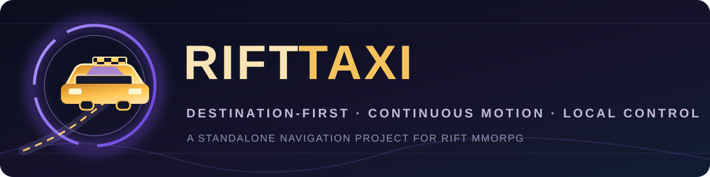

<div align="center">



<br />

**Choose your destination. Keep moving. Let the local controller handle the route.**

[](docs/ROADMAP.md)
[](docs/M1_IMPLEMENTATION.md)
[](pyproject.toml)
[](docs/ARCHITECTURE.md)

*A standalone, destination-driven navigation project for the RIFT MMORPG.*

[**Explore the roadmap**](docs/ROADMAP.md) · [**See what works**](#-current-state) · [**Run the offline tools**](#-try-the-offline-tools) · [**Documentation**](#-documentation)

</div>

---

## 🚕 The idea

**Select a destination, press Go, and travel smoothly from start to finish.**

RIFT Taxi is being built to treat the **destination** as the objective—not each waypoint as a place to stop. The eventual controller will follow qualified, traversable corridors, steer **while moving**, skip or merge ordinary guide points where safe, and stop for genuine constraints or final arrival.

> **The measure of success is a verified, smooth end-to-end journey—not a high count of waypoints reached.**

### ✨ Design pillars

| 🎯 Destination-first | 🛣️ Continuous motion | 🧠 Local autonomy |
|:---|:---|:---|
| Navigate toward a chosen destination rather than a rigid chain of stop points. | Keep moving through ordinary route guides; turn while forward movement is active. | Planning, steering, progress checks and recovery run locally—no AI service is required during a journey. |

| 🧭 Evidence-backed routes | 🛑 Reliable STOP | 📦 Standalone by design |
|:---|:---|:---|
| Respect verified corridors, mandatory passages, build/zone provenance and unknown obstacles. | Treat input release, stale observations and session changes as explicit control conditions. | Reuse sister-project research without depending on those projects at runtime. |

## 📍 Current state

> [!IMPORTANT]
> **M1 is in progress, not complete.** The offline replay CLI, RR2 evidence importer, synthetic steering preview and driver-neutral STOP/held-input gate exist, with **63 regression tests passed on Nov 23**. There is **no verified Taxi-owned native live position reader, Windows game-input backend, completed Taxi journey or packaged desktop application yet**.

| Component | Status | Evidence / next gate |
|:---|:---|:---|
| Repository, contracts and design | ✅ Documented | [Architecture](docs/ARCHITECTURE.md) · [Product specification](docs/PRODUCT_SPEC.md) |
| Deterministic motion-trace replay | ✅ Implemented offline | [M1 implementation](docs/M1_IMPLEMENTATION.md) |
| RR2 source-provenance importer | ✅ Implemented offline | Historical original-source receipt; not a Taxi live run |
| Synthetic continuous-steering preview | ✅ Implemented offline | Produces steering intent, not physical movement |
| Driver-neutral W/A/D and watchdog STOP gate | ✅ Implemented offline | [M1 control-boundary tests](docs/M1_CONTROL_BOUNDARY.md); no game input |
| Taxi-owned fresh XYZ and actor-facing reader | 🔧 Next | Process/build/actor binding and observation freshness |
| Native Windows W/A/D backend and independently supervised release | 🔧 Next | Physical confirmation of actual game response and settled release |
| Smooth multi-bend live journey | ⏳ Not verified | Measured course with continuous forward travel |
| Desktop UI and portable distribution | ⏳ Planned | PySide6 target after the control milestones |

**Evidence matters:** simulated steering, successful OS input insertion, candidate native coordinates, a computed path and actual in-game arrival are **different claims**. RIFT Taxi will report them separately.

## 🗺️ Roadmap

```text
M0  Foundation & contracts           ✅ Documented
 │
 ▼
M1  Replay + pose/input substrate    ◐ Offline implemented · live pending
 │
 ▼
M2  Continuous straight travel      ○ Planned
 │
 ▼
M3  Smooth multi-bend driving        ○ Planned  ★ Core experience
 │
 ▼
M4  Verified local destination maps  ○ Planned
 │
 ▼
M5  Obstacle detection & recovery    ○ Planned
 │
 ▼
M6  Standalone desktop experience    ○ Planned
```

**Immediate critical path:** fresh, Taxi-owned XYZ/facing telemetry → bounded movement input and STOP → measured straight travel → smooth multi-bend travel. The [full roadmap](docs/ROADMAP.md) contains acceptance gates and evidence requirements for every milestone.

## 🧩 How it fits together

```text
                   ┌─────────────────────────────┐
                   │         RIFT TAXI           │
                   │  destination & local logic  │
                   └──────────────┬──────────────┘
                                  │
                ┌─────────────────┴─────────────────┐
                ▼                                   ▼
       Pose / facing reader                  Movement controller
       (Taxi-owned; planned)                 (Gate built; driver planned)
                │                                   │
                └─────────────────┬─────────────────┘
                                  ▼
                       Verified RIFT session

       Versioned, local route evidence ──► Route acceptance
       (imported from research)           and trajectory tracking
```

**Runtime boundary:** RIFT is needed for live play; RR2, RiftWorld, Telara Fly, Workbridge, ChatGPT, cloud AI and other development tools are **not** runtime requirements. The design is **Python-first** with a scriptable CLI and a **planned PySide6 UI**. A small bundled Windows-native helper is possible only if measurement shows it is necessary.

### 🔗 Related research — reused, not duplicated

- **RiftReader2 (RR2):** native pose/input research and original movement evidence. Source receipts are imported with provenance.
- **RiftWorld:** world, geometry, collision and route research. Taxi should consume qualified **versioned local packages**, not rebuild the map pipeline.
- **Telara Fly:** permanently **read-only reference**; no direct Taxi runtime dependency or source modification.

See [research imports](docs/RESEARCH_IMPORTS.md), [RR2 handoff](docs/RR2_HANDOFF.md), [RiftWorld handoff](docs/RIFTWORLD_HANDOFF.md), [Telara Fly reference](docs/TELARA_FLY_REFERENCE.md) and [integration contracts](docs/INTEGRATION_CONTRACTS.md).

## 🧪 Try the offline tools

These commands exercise **offline analysis only**. They do **not** launch RIFT, read live game memory or send game input.

Open **PowerShell** in the local repository directory (documented working checkout: `C:\work\Rift_Taxi` on **LEGION**):

```powershell
cd C:\work\Rift_Taxi

# Environment and fixture diagnostics
python -B -m rift_taxi doctor

# Compare stop/go with synthetic continuous travel
python -B -m rift_taxi compare samples\synthetic_stop_go.json samples\synthetic_continuous.json

# Preview steering intent against a synthetic motion trace
python -B -m rift_taxi preview-steering samples\synthetic_continuous.json

# Re-run the regression suite
python -B -m unittest discover -s tests -v
```

The historical RR2 import includes a **72-position / 14-key-event** original-source receipt. Its source and limitations are explained in [M1 implementation](docs/M1_IMPLEMENTATION.md); it does **not** establish a Taxi-owned live journey.

## 📚 Documentation

| Start here | Deep dives |
|:---|:---|
| [📌 Product specification](docs/PRODUCT_SPEC.md) | Waypoint types, destination semantics and stopping rules |
| [🏗️ Architecture](docs/ARCHITECTURE.md) | Local controller, observation and input boundaries |
| [🗺️ Development roadmap](docs/ROADMAP.md) | Milestones, priorities and acceptance gates |
| [📏 Validation](docs/VALIDATION.md) | Benchmarks and measurable movement quality |
| [🔬 M1 implementation](docs/M1_IMPLEMENTATION.md) | Commands, trace provenance, test receipts and limitations |
| [🛑 M1 control gate](docs/M1_CONTROL_BOUNDARY.md) | Driver-neutral W/A/D, expiry watchdog, STOP/fault tests and live blockers |
| [🔌 Integration contracts](docs/INTEGRATION_CONTRACTS.md) | Existing upstream formats versus proposed Taxi formats |
| [📖 Documentation hub](docs/README.md) | Index of research, handoffs and architecture notes |
| [📝 Durable decisions](docs/DECISIONS.md) | Project decisions and non-negotiable boundaries |
| [📍 Curated destinations](docs/NPC_DESTINATIONS.md) | Travel targets for services and selected NPCs |
| [🤝 Developer instructions](AGENTS.md) | Local workflow and repository-specific guardrails |

## 🔭 What's next?

1. **Finish M1:** implement fresh Taxi-owned current-player XYZ/yaw observation and a bounded native Windows W/A/D backend; physically qualify release/STOP beyond the tested driver-neutral gate.
2. **Measure real behavior:** verify yaw response, movement latency, coast and post-release evidence rather than extrapolating from synthetic traces.
3. **Prove M2–M3:** achieve a measured straight arrival, then a qualified multi-bend journey with no unnecessary stops at guide points.
4. **Expand only on evidence:** introduce local world packages, recovery and UI after the movement foundation is dependable.

---

<div align="center">

**RIFT Taxi** · *Destination over waypoints. Motion over stop-and-go. Evidence over assumptions.*

[↑ Back to top](#)

<sub>Independent community research project. Not affiliated with the RIFT game publisher.</sub>

</div>
